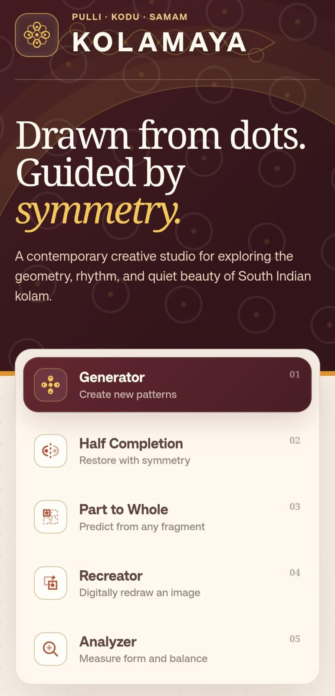
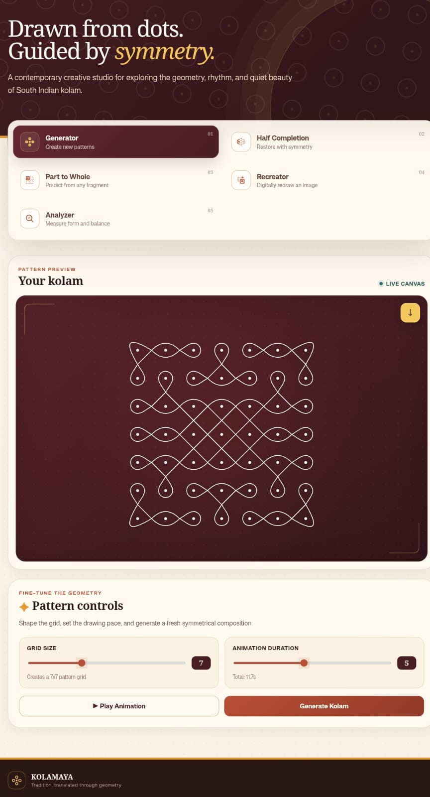
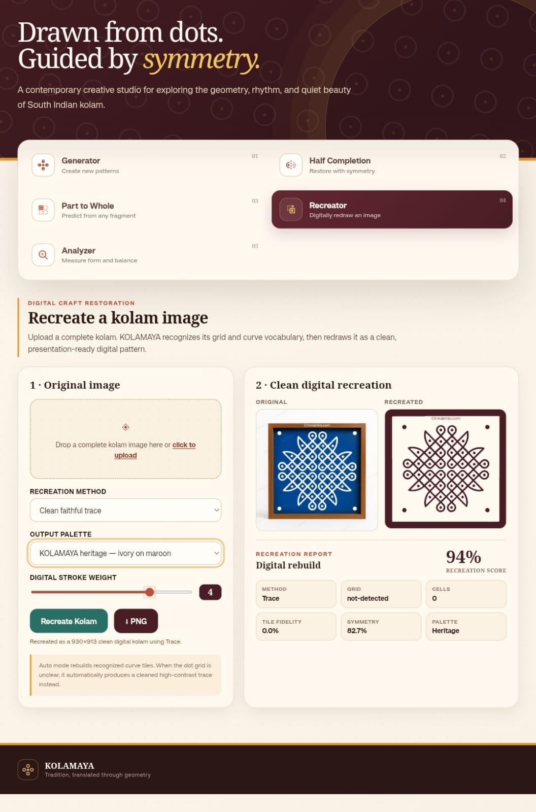

# KOLAMAYA – Digital Kolam Creation & Analysis Platform

KOLAMAYA is a team project that brings traditional South Indian Kolam art together with modern technology.

## ✨ Key Features

- **Generator:** Create new Kolam patterns.
- **Half Completion:** Restore incomplete patterns using symmetry.
- **Part to Whole:** Predict complete Kolam designs from fragments.
- **Recreator:** Digitally redraw Kolam images.
- **Analyzer:** Measure pattern form and balance.

##  About the Project

KOLAMAYA explores the geometry, rhythm and beauty of traditional South Indian Kolam through modern digital technology.

##  Live Demo
https://kolamayaai.vercel.app/

##  Project Type
Team Project 

## 📸 Project Screenshots

### Homepage

### Generator

### Recreator

